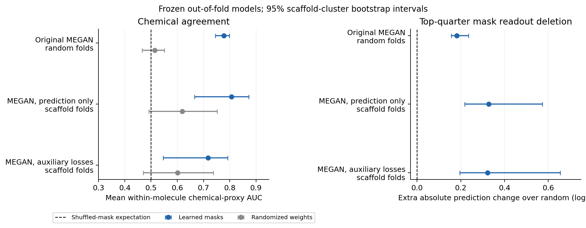
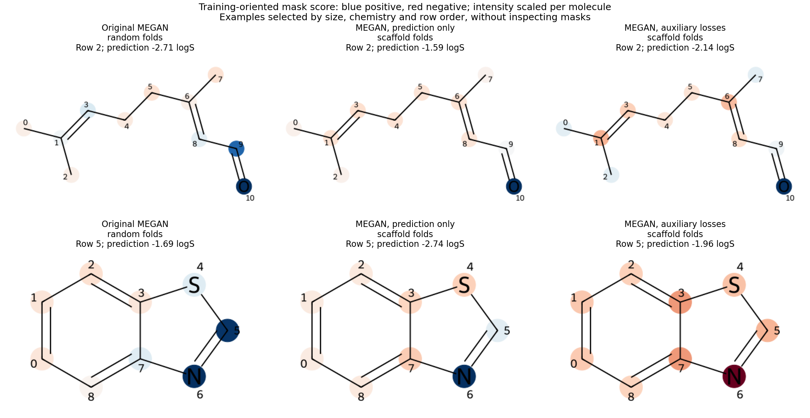

# Do learned MEGAN masks contain chemical signal?

**Yes, on the tested chemical proxies.** Masks from the original ESOL reproduction and the prediction-only scaffold model distinguish polar N/O atoms from nonpolar carbon regions better than shuffled masks and parameter-randomized controls. Highly ranked masks also identify pooling contributions that affect predictions more than equal-sized random deletions. This supports chemical agreement and readout faithfulness, without establishing chemically causal atom explanations.

## Frozen evaluation

The [protocol](../../experiments/mask-chemistry/protocol.json) was fixed before examining mask outcomes. Three existing five-fold model sets were evaluated without retraining or selecting channels on held-out chemistry:

| Model set | Split | Held-out molecules | Explanation/sparsity losses |
| --- | --- | ---: | --- |
| [Original KGCNN reproduction](../paper-esol/README.md) | Random | 1,127 | Both zero |
| [Prediction-only PyTorch MEGAN](../scaffold-megan-no-aux/README.md) | Scaffold | 1,128 | Both zero |
| Fixed `embedding_joint_32` control | Same scaffold folds | 1,128 | 0.1 / 0.01 |

The PyTorch models form the matched comparison. The original benchmark changes architecture, features and splitting together, so differences between it and the scaffold models cannot isolate one cause.

## Chemical agreement

The primary proxy compares nitrogen/oxygen atoms with neutral carbon atoms whose heavy-atom neighbours are all carbon. Carbon directly attached to heteroatoms is excluded from this comparison. These are deliberately simplified proxies, inspired by the [paper's solubility discussion](https://arxiv.org/pdf/2211.13236#page=13); they are not atom-level solubility labels. All three cohorts contain the same 747 eligible molecules, spanning 212 scaffold groups.

Unsigned masks do not specify whether a contribution raises or lowers the prediction. For each fold, channel direction is calibrated using **training molecules only**: remove each entire channel from final pooling and take the sign of its mean full-minus-ablated prediction. A node's oriented score is:

```text
score(atom i) = sum_k sign(mean_training_channel_effect[k])
                     * mask[i,k] / max(mean_atoms(mask[:,k]), 1e-12)
```

Channel normalization removes differences in channel-wide gate scale. No chemistry labels enter calibration. Global channel signs remain an approximation: an individual channel can behave differently for different molecules. We report AUC within each eligible molecule, then average equally across molecules; 0.5 is the shuffled expectation. We do not report atom-pooled AUC or choose whichever channel scores best on test chemistry.

| Model | Mask AUC (95% CI) | Shuffled AUC | Random-weight AUC | Paired mask minus random-weight AUC (95% CI) |
| --- | ---: | ---: | ---: | ---: |
| Original, random folds | **0.777 [0.745, 0.799]** | 0.499 | 0.514 | **0.263 [0.217, 0.311]** |
| Prediction only, scaffold folds | **0.806 [0.666, 0.873]** | 0.501 | 0.619 | **0.187 [0.042, 0.347]** |
| Auxiliary losses, scaffold folds | 0.717 [0.546, 0.792] | 0.501 | 0.601 | 0.116 [−0.025, 0.266] |

The auxiliary model shows agreement with the coarse chemical proxy, but its advantage over the random-weight control is less conclusive. One independently initialized model per fold uses seed `1042 + fold`; its masks receive the trained model's same calibration signs. Shuffling permutes atom scores within each molecule 100 times. Both controls preserve molecule size and composition.

A secondary check correlates oriented masks with negative [Wildman–Crippen atomic logP contributions](https://www.rdkit.org/docs/cppapi/namespaceRDKit_1_1Descriptors.html). Mean within-molecule Spearman correlations are 0.246, 0.142 and 0.134, respectively. Agreement is modest; calculated logP contributions are a proxy for hydrophobicity, not measured atom-level logS effects. Undefined correlations are omitted and their counts are recorded.

## Readout faithfulness

For every held-out molecule, we remove `ceil(0.25 × atom_count)` atoms' contributions from all channels at **final weighted pooling**. The graph, atom/bond features, encoder and learned masks remain fixed. Atoms are ranked by mean unsigned mask across channels; ties are broken with a seeded permutation. Controls remove the same number of low-ranked atoms or uniformly sampled atoms, with 100 random samples per molecule.

| Model | Top-mask absolute prediction change | Random deletion change | Paired extra change over random (95% CI), logS |
| --- | ---: | ---: | ---: |
| Original, random folds | 1.044 | 0.863 | **0.181 [0.156, 0.236]** |
| Prediction only, scaffold folds | 1.008 | 0.681 | **0.327 [0.218, 0.573]** |
| Auxiliary losses, scaffold folds | 1.031 | 0.709 | **0.322 [0.196, 0.654]** |

Mean within-molecule correlations between mask magnitude and absolute single-atom pooling effects are 0.386, 0.527 and 0.549. These results support ranking faithfulness at the readout. Removing pooling contributions is an intervention on the model, not a chemically valid molecular edit; it leaves information already propagated from those atoms inside other embeddings.



## Channel semantics and auxiliary-loss comparison

Training-calibrated signs vary across folds. With the PyTorch models' nominal `[-1,+1]` channel labels, mean chemical-proxy AUC is only 0.466 without auxiliary losses and 0.526 with them; both scaffold-cluster intervals span 0.5. Fixed positive/negative labels therefore need independent validation before interpretation.

The [paired scaffold comparison](paired_scaffold_comparison.csv) gives prediction-only minus auxiliary mask AUC **+0.089 [0.033, 0.179]** after training-only calibration. Their extra deletion effect differs by just +0.005 logS, with an interval spanning zero. Thus auxiliary penalties are not required for chemical signal in this experiment, and do not improve this particular calibrated-mask proxy. Both explanation and sparsity penalties, and the loss-driven scheduler trajectory, differ; their individual effects remain unresolved. These are exploratory, conditional comparisons rather than a general claim about explanation co-training.



Examples are the first eligible nonaromatic and aromatic rows with 6–12 atoms, both proxy classes and no disconnected fragments: [selection record](figure_examples.json). Selection uses structure and row order, without inspecting masks or prediction quality. Colors show the training-oriented mask score, scaled within each molecule; they do not depict chemical counterfactual effects. An individual example can contradict the aggregate trend.

## Evidence and reproduction

Download the [comparison table](comparison.csv), [paired scaffold comparison](paired_scaffold_comparison.csv), [verification record](verification.json), [figure SVG](chemistry_summary.svg) and [evaluation source snapshot](evaluation_source.tar.gz). Each cohort contains a summary with calibrated signs and checkpoint hashes, a per-molecule CSV, and compressed atom/edge masks:

- [Original model evidence](paper_random_prediction_only/summary.json), [molecule metrics](paper_random_prediction_only/molecule_metrics.csv), [masks](paper_random_prediction_only/atom_masks.json.gz).
- [Prediction-only evidence](scaffold_prediction_only/summary.json), [molecule metrics](scaffold_prediction_only/molecule_metrics.csv), [masks](scaffold_prediction_only/atom_masks.json.gz).
- [Auxiliary-control evidence](scaffold_joint_auxiliary/summary.json), [molecule metrics](scaffold_joint_auxiliary/molecule_metrics.csv), [masks](scaffold_joint_auxiliary/atom_masks.json.gz).

All 15 checkpoint hashes match their original experiment records. All 3,383 held-out predictions agree with the earlier exports within 1.3e-6 logS. Input atom identity/order is checked against RDKit; original cached graphs also pass bond-topology checks. Readout reconstruction is checked against each model's unchanged forward computation. Atom-level AUCs are independently recomputed with scikit-learn, rank correlations with SciPy, and all aggregate means audited.

With the existing local checkpoints and both previously documented environments:

```bash
make mask-chemistry
```

To audit saved metrics without executing models:

```bash
.venv/bin/python backend/scripts/summarize_mask_chemistry.py
```

The model-evaluation commands require the locally retained checkpoints from the preceding experiments; weights are ignored and are not bundled with this result table. A fresh checkout must first reproduce those runs, preserving their corresponding predictions and checkpoint records. These scripts evaluate frozen evidence rather than choosing new models from test outcomes.

Four new diagnostic tests passed. The broader research suite returned 39 passes, one failure because the existing `notebooks/megan_pytorch.ipynb` reference is missing, and one deselection for the previously stalled API TestClient startup test. The missing notebook does not affect these model evaluations.

## Limits

ESOL has no ground-truth atom explanations. Polar motifs do not invariably increase solubility: ionization, pH, crystal packing and broader molecular context matter. These checks establish agreement with chosen heuristics, not mechanistic correctness or improved prediction from masks. We evaluate node masks; edge masks are exported but not independently chemically validated.

Intervals use 2,000 bootstrap resamples of Bemis–Murcko scaffold clusters, including the shared empty scaffold. They describe sampling variation conditional on the existing trained models; they do not capture training-seed variation or make the overlapping fold training sets independent. This exploratory analysis uses previously inspected outer folds, one randomized initialization per fold and multiple diagnostics. Confirmation on another dataset and an independent chemistry-labelled explanation benchmark remains future work.
