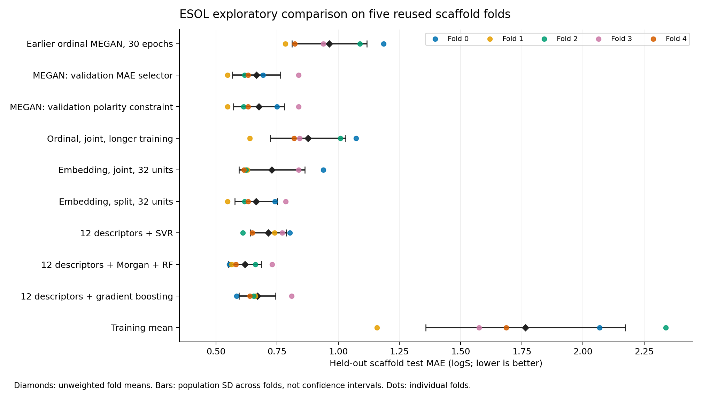

# ESOL scaffold experiments — 2026-10-09

Validation-only search substantially improved MEGAN's predictive error over the
[earlier 30-epoch experiment](../scaffold-esol/README.md). The descriptor-plus-Morgan
random forest still had the lowest MAE among the evaluated model families. Selecting
MEGAN with an explanation-channel constraint improved measured channel behavior,
but did not make the explanations reliable for every molecule.

This is an **exploratory follow-up on previously inspected outer folds**. Choices
in this run were frozen using inner validation only before outer evaluation, but
the earlier test assessment informed the follow-up design. These results do not
establish an untouched benchmark, statistical superiority, or the best achievable
ESOL result. They do not support the historical 0.45 logS CV claim.

## Predictive results

All errors are in original-unit logS. “±” is the **population standard deviation
across five folds**, not a confidence interval or variation across independent
training-seed repetitions. Fold means weight folds equally; pooled metrics weight
molecules equally. Test sizes are unequal.

| Model / prespecified comparison                    |  Fold-mean MAE ± SD | Pooled MAE | Pooled RMSE |  Pooled R² |
| -------------------------------------------------- | ------------------: | ---------: | ----------: | ---------: |
| Earlier ordinal MEGAN, at most 30 epochs           |     0.9636 ± 0.1534 |     0.9785 |      1.2202 |     0.6609 |
| MEGAN: minimum validation MAE selector             |     0.6651 ± 0.0979 |     0.6613 |      0.8465 |     0.8368 |
| MEGAN: validation channel-polarity constraint      |     0.6759 ± 0.1041 |     0.6768 |      0.8672 |     0.8288 |
| Fixed ordinal, joint updates, longer training      |     0.8761 ± 0.1533 |     0.8846 |      1.0958 |     0.7265 |
| Fixed embeddings, joint updates, 32 units          |     0.7282 ± 0.1346 |     0.7467 |      0.9541 |     0.7927 |
| Fixed embeddings, split updates, 32 units          |     0.6641 ± 0.0865 |     0.6660 |      0.8578 |     0.8324 |
| 12 RDKit descriptors + SVR                         |     0.7141 ± 0.0731 |     0.7260 |      0.9702 |     0.7857 |
| 12 RDKit descriptors + Morgan + random forest      | **0.6182 ± 0.0669** | **0.6077** |  **0.8069** | **0.8517** |
| 12 RDKit descriptors + histogram gradient boosting |     0.6695 ± 0.0747 |     0.6592 |      0.8734 |     0.8263 |
| Training-mean predictor                            |     1.7653 ± 0.4080 |     1.7640 |      2.2178 |    -0.1201 |

[Download comparison.csv](comparison.csv), [per-fold metrics](fold_metrics.csv),
[all 1,128 held-out predictions](predictions.csv), and [the plot as PDF](fold_mae.pdf).



| Fold | Test molecules | MEGAN MAE selector | MEGAN polarity constraint | Descriptor SVR | Descriptor + Morgan RF | Descriptor HGB |
| ---- | -------------: | -----------------: | ------------------------: | -------------: | ---------------------: | -------------: |
| 0    |            317 |             0.6927 |                    0.7501 |         0.8027 |                 0.5550 |         0.5849 |
| 1    |            254 |             0.5477 |                    0.5477 |         0.7388 |                 0.5646 |         0.6611 |
| 2    |            186 |             0.6165 |                    0.6129 |         0.6098 |                 0.6609 |         0.6538 |
| 3    |            186 |             0.8378 |                    0.8378 |         0.7703 |                 0.7291 |         0.8090 |
| 4    |            185 |             0.6309 |                    0.6309 |         0.6490 |                 0.5815 |         0.6384 |

Longer ordinal training improved MAE from 0.9636 to 0.8761. At 32 hidden units,
changing ordinal inputs to learned embeddings with joint updates reached 0.7282;
using split updates reached 0.6641. These are observed differences on one manifest
and one seed per fold. Split training makes two optimizer updates per batch, so
these comparisons are epoch-matched, **not matched for update count or compute**.
The fixed split variant's slightly lower fold-mean test MAE does not replace the
prespecified selector or change the deployment rule.

## Dataset, representation, splits, and search

The data are 1,128 ESOL/Delaney aqueous logS targets and RDKit/PyG molecular graphs.
The [raw-data checksum](../../backend/data/README.md) and [exact split manifest](splits.json)
are retained. Nine atom categorical fields and three bond categorical fields use
the shared preprocessing; physical bonds have both directions, no explicit hydrogens
are added, and internal self-loops receive zero bond features.

The splitter uses typed, nonchiral Bemis–Murcko scaffolds: 269 groups, with **all
acyclic molecules in the same empty-scaffold group**. Train, inner validation, and
outer test have disjoint scaffolds within each fold. Every molecule is tested once.
This is a specific scaffold policy, not a universal definition of molecular novelty.

| Fold | Training rows | Validation rows | Test rows | Training seed |
| ---- | ------------: | --------------: | --------: | ------------: |
| 0    |           730 |              81 |       317 |            42 |
| 1    |           787 |              87 |       254 |            43 |
| 2    |           847 |              95 |       186 |            44 |
| 3    |           848 |              94 |       186 |            45 |
| 4    |           849 |              94 |       185 |            46 |

Split seed is 42. Targets are standardized using training rows only. For each
candidate and fold, inner validation MAE selects the epoch; cloned weights are
restored before validation-channel measurements and outer evaluation. Baselines
also fit only training rows and select hyperparameters on inner validation.

[scaffold_search.yaml](../../backend/configs/scaffold_search.yaml) fixed eight MEGAN
candidates before fitting, for **40 trials** and 4,121 actual trial epochs. Common
settings: two channels, one attention head, bond features, residual connections,
LayerNorm, batch 64, AdamW weight decay 1e-5, maximum 150 epochs, patience 20,
node sparsity weight 0.01, decorrelation weight zero, and a validation-total-loss LR
scheduler. Base learning rate is 0.001, dropout 0.1, three layers and auxiliary
weight 0.1; deviations follow below. Each categorical field has its own embedding table with 16-dimensional vectors,
yielding 144 atom-input and 48 bond-input dimensions.

| Candidate ID                 | Encoding   | Hidden units | Layers | Updates | Other overrides                                       |
| ---------------------------- | ---------- | -----------: | -----: | ------- | ----------------------------------------------------- |
| `ordinal_long`               | Ordinal    |           32 |      3 | Joint   | Same model as the earlier run, longer budget/patience |
| `embedding_joint_32`         | Embeddings |           32 |      3 | Joint   | Base                                                  |
| `embedding_split_32`         | Embeddings |           32 |      3 | Split   | Base                                                  |
| `embedding_joint_64`         | Embeddings |           64 |      3 | Joint   | Base                                                  |
| `embedding_split_64`         | Embeddings |           64 |      3 | Split   | Base                                                  |
| `embedding_split_slow`       | Embeddings |           64 |      2 | Split   | LR 0.0005, dropout 0.2                                |
| `embedding_joint_weak_aux`   | Embeddings |           64 |      2 | Joint   | LR 0.0005, auxiliary weight 0.01                      |
| `embedding_split_strong_aux` | Embeddings |           64 |      3 | Split   | Auxiliary weight 0.5                                  |

The complete resolved configurations, rules, split/source hashes, and static test
ablations are in [search_plan.json](search_plan.json). All trial validation scores,
normalization values, selected epochs, actual epoch counts, elapsed durations, and
weight checksums are in [trials.json](trials.json), [validation_trials.csv](validation_trials.csv),
and [training_history.json](training_history.json).

Two selectors were fixed in advance: lowest validation MAE, and lowest validation
MAE among candidates with **both channel-mean signed validation ablations ≥ 0**.
If no candidate qualifies, the latter falls back to the former. Ties use candidate ID.
All MEGAN and baseline choices were written to [selection.json](selection.json)
before outer test evaluation. The three fixed test ablations were also declared
in the frozen plan; they are not test-selected winners.

| Fold | MAE-selected candidate (epochs) | Polarity-selected candidate (epochs) | Validation constraint satisfied? |
| ---- | ------------------------------- | ------------------------------------ | -------------------------------- |
| 0    | `embedding_split_64` (125)      | `embedding_split_strong_aux` (79)    | Yes                              |
| 1    | `embedding_split_32` (59)       | `embedding_split_32` (59)            | **No: fallback**                 |
| 2    | `embedding_split_32` (93)       | `embedding_joint_64` (86)            | Yes                              |
| 3    | `embedding_joint_32` (97)       | `embedding_joint_32` (97)            | Yes                              |
| 4    | `embedding_split_32` (96)       | `embedding_split_32` (96)            | Yes                              |

The descriptor list is MolWt, MolLogP, TPSA, NumHDonors, NumHAcceptors,
NumRotatableBonds, RingCount, NumAromaticRings, FractionCSP3, HeavyAtomCount,
LabuteASA, and NumHeteroatoms. Seven baseline configurations per fold produced
**35 fits**, recorded in [baseline_trials.json](baseline_trials.json):

- RBF SVR with a training-fitted StandardScaler: C=10 or 100 with gamma=`scale`,
  or C=100 with gamma=0.01. Other parameters retain scikit-learn 1.5.2 defaults.
- Histogram gradient boosting: 300 iterations, 15 leaves, L2=1, minimum leaf size
  10 or 20, early stopping disabled, fold seed; remaining parameters are defaults.
- Random forest on concatenated descriptors and radius-2/1,024-bit Morgan
  fingerprints: 300 trees, max_features=0.5, minimum leaf size 1 or 2, one worker,
  fold seed; remaining parameters are defaults.

The earlier Morgan-only forest did not use descriptors or validation selection;
its poor score is not the score of the stronger baseline evaluated here.

## Explanation-channel behavior

For the same trained forward path, mask each channel's learned node contribution
and measure `delta_negative = prediction_without_0 - full_prediction` and
`delta_positive = full_prediction - prediction_without_1`. Multiply standardized
changes by the training target standard deviation. Fidelity\* averages both signed
changes over molecules; absolute changes would discard the intended polarity.
Zero changes count as nonnegative, so the fractions measure sign consistency,
not a minimum useful effect size.

For the polarity-constrained selector:

| Fold | Mean negative-channel delta | Mean positive-channel delta | Fidelity\* | Negative sign correct | Positive sign correct | Both signs correct |
| ---- | --------------------------: | --------------------------: | ---------: | --------------------: | --------------------: | -----------------: |
| 0    |                      1.2869 |                      0.2713 |     0.7791 |                 99.1% |                 76.3% |              75.4% |
| 1    |                      2.4400 |                 **-0.7756** |     0.8322 |                100.0% |              **9.4%** |           **9.4%** |
| 2    |                      4.5403 |                      0.3864 |     2.4633 |                100.0% |                 86.6% |              86.6% |
| 3    |                      3.6861 |                      1.5042 |     2.5951 |                100.0% |                 96.2% |              96.2% |
| 4    |                      4.2508 |                      0.8867 |     2.5687 |                100.0% |                 80.5% |              80.5% |

Mean fidelity* is positive in every fold, but fold 1's positive channel still
behaves mostly contrary to its intended role. Across all held-out molecules,
**752/1,128 (66.7%)** have both expected channel signs, versus **352/1,128 (31.2%)**
for the MAE-only selector. Its fidelity* is negative in folds 0 and 2.

Download [all channel metrics](explanation_metrics.csv) and [per-molecule signed
ablations for all five MEGAN tracks](channel_ablations.csv). Continuous mean node
and edge masks are recorded; they are not thresholded retained-node fractions.
ESOL has no ground-truth atom attribution labels. These measurements do not
establish chemically correct explanations, causality, explanation stability, or
an advantage over established graph explainers. More auxiliary weight alone does
not ensure useful channel roles.

## Verification and inference refit

The [audit](verification.json) checked the frozen plan and all 39 source hashes,
40 MEGAN checkpoint hashes, 35 baseline artifact hashes, training-only target
scalers, validation-only selections, split disjointness, and exactly one outer
test row per molecule. All **10,152 predictions across nine tracks replayed with
zero difference**; direct formulas independently reproduced all fold and pooled
metrics. All 5,640 channel-ablation records and the reported sign fractions replayed.
The ordinal candidate's first 30 epochs matched the earlier run exactly on all
five folds, including every recorded training/validation loss and validation MAE.
The deterministic research suite passed **32 tests** before this full run.

The deployment rule was fixed before outer evaluation: the most frequent candidate
selected by the polarity selector, ties by mean validation MAE across folds, then
median selected epoch count **for that candidate** across all five folds. It chose
`embedding_split_32`; its selected epoch counts were 141, 59, 93, 69, and 96, giving
**93 refit epochs**. It was trained on all 1,128 rows with seed 42 after test reports
were finalized. This model has **no independent ESOL test score**; the pipeline's
cross-validation results cannot be assigned directly to its weights.

The refit is local at `backend/models/trained/scaffold-tuned/model.pth`, architecture
`megan-regression-embedded-v3`, SHA-256
`34c93a7cf8bd9f52c77955f040ded83de5d237ad058bccfd190efae25f668248`.
[deployment.json](deployment.json) and [deployment_config.yaml](deployment_config.yaml)
record its selection and configuration. The original model remains separate.

[The real API check](api_verification.json) passed readiness, strict checkpoint
loading, atom/bond alignment of learned masks, deterministic prediction restoration
after 10 MC dropout samples, and unsupported-input errors. Ethanol and aspirin
returned finite predictions; these examples are integration checks, not a new
accuracy benchmark. Dropout spread remains uncalibrated and confidence is null.

Weights and joblib files remain ignored local artifacts; **no remote checkpoint
release has been published**. Reports, exact splits/configuration, histories,
checksums, and predictions are retained here; rerunning training is required to
recover weights from a fresh checkout until a release is published.

## Repository cleanup and archival replay

After this run, obsolete source was removed from active paths.
[source.tar.gz](source.tar.gz) preserves all 39 original source files, byte-for-byte
against the frozen plan hashes. The verification helper automatically uses this
snapshot when maintained source differs, then checks the same predictions/metrics.
Install `backend/requirements/tracking.txt` to satisfy its original MLflow imports.
The run's recorded environment remains unchanged.

Local fold artifacts were compressed into
`backend/models/trained/scaffold-tuned/folds.tar.gz`, verifying all 195 members
byte-for-byte before removing expanded copies. The helper automatically unpacks
them in temporary storage. The inference refit remains directly loadable. To resume
the recorded search or use its raw evaluation CLI, unpack the archive first:

```bash
# From backend/:
tar -xzf models/trained/scaffold-tuned/folds.tar.gz -C models/trained/scaffold-tuned
```

Fresh reproduction with maintained source uses a new provenance hash and separate
output directories. To reproduce the exact recorded implementation, overlay the
source snapshot in a separate checkout and use the original resolved environment.
Neither cleanup nor repackaging changes the reported model results.

## Exact reproduction commands

Use Python 3.11 and the [root installation instructions](../../README.md#install-test-and-reproduce).
[environment.json](environment.json), [requirements-resolved.txt](requirements-resolved.txt),
and [execution.json](execution.json) record the actual environment: Python 3.11.15,
CPU Torch 2.4.1, torch-scatter 2.1.2, PyG 2.6.1, RDKit 2025.3.2, NumPy 1.26.4,
and scikit-learn 1.5.2. Source hashes describe the actual modified working source;
the recorded Git HEAD alone is insufficient. Architecture versions per trial and
the refit are authoritative; the environment metadata's default architecture field
describes the ordinal class default.

The executed commands, from `backend/`, were:

```bash
MPLBACKEND=Agg OMP_NUM_THREADS=1 MKL_NUM_THREADS=1 PYTHONHASHSEED=42 \
../.venv/bin/python -u scripts/tune_model.py \
  --search-config configs/scaffold_search.yaml \
  --splits ../results/scaffold-esol/splits.json \
  --save-dir models/trained/scaffold-tuned \
  --results-dir ../results/scaffold-tuning --workers 3 --stage search

MPLBACKEND=Agg OMP_NUM_THREADS=1 MKL_NUM_THREADS=1 PYTHONHASHSEED=42 \
../.venv/bin/python -u scripts/tune_model.py \
  --save-dir models/trained/scaffold-tuned \
  --results-dir ../results/scaffold-tuning --stage evaluate --refit
```

For a fresh reproduction, use separate outputs and both stages together:

```bash
cd backend
MPLBACKEND=Agg OMP_NUM_THREADS=1 MKL_NUM_THREADS=1 PYTHONHASHSEED=42 \
../.venv/bin/python -u scripts/tune_model.py \
  --search-config configs/scaffold_search.yaml \
  --splits ../results/scaffold-tuning/splits.json \
  --save-dir models/trained/scaffold-tuning-reproduction \
  --results-dir results/scaffold-tuning-reproduction \
  --workers 3 --stage all --refit
```

Search resumes completed trials only when plan/source and checkpoint hashes match;
it rejects changed source/configuration in an existing run directory. Evaluation
requires all candidates to be complete. Use `--workers 1` for sequential execution.
Training uses local raw ESOL data; MLflow logging is not part of this search CLI.

Run tests and replay the recorded local artifacts from the repository root:

```bash
MPLBACKEND=Agg OMP_NUM_THREADS=1 MKL_NUM_THREADS=1 PYTHONHASHSEED=42 \
.venv/bin/python -m pytest -q backend/tests/research

MPLBACKEND=Agg OMP_NUM_THREADS=1 MKL_NUM_THREADS=1 PYTHONHASHSEED=42 \
.venv/bin/python results/scaffold-tuning/verify_results.py

MPLBACKEND=Agg OMP_NUM_THREADS=1 MKL_NUM_THREADS=1 PYTHONHASHSEED=42 \
.venv/bin/python results/scaffold-tuning/verify_api.py
```

Point the demo at the refit explicitly, from `backend/`:

```bash
MEGAN_MODEL_PATH=models/trained/scaffold-tuned/model.pth \
../.venv/bin/python -m uvicorn main:app --reload
```

The [learning guide's follow-up derivation](../../docs/reproducing-megan.md#10-derive-the-follow-up-experiments)
explains categorical embeddings, split optimizer updates, selection rules, and
their verification. This implements MEGAN's structural ideas and update order
with documented loss/optimizer choices on ESOL, not an exact replication of the
original paper's AqSolDB benchmark. One reused split seed, one training seed per
fold, an eight-candidate budget, no second GNN family, and no calibrated uncertainty
limit what can be concluded. Exact outcomes on different libraries or hardware
are not promised.
